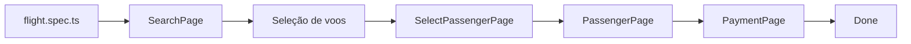

# Flight Booking Scenarios

Suíte de testes end-to-end para o fluxo de reserva de voos do site [QAPractice](https://www.qapractice.com). O projeto usa **TypeScript** e **Playwright**, aplicando o padrão **Page Object Model (POM)** para separar a interação com a interface da definição dos cenários de teste.

## Objetivo

Os testes cobrem:

- Busca de voos de ida e volta.
- Busca de voo somente de ida.
- Seleção de voo de partida e, quando aplicável, de retorno.
- Preenchimento dos dados do passageiro.
- Preenchimento do pagamento e finalização da reserva.
- Validações de origem e destino iguais.
- Validações de datas de retorno inválidas.
- Mensagens de obrigatoriedade para campos vazios.

## Estrutura

```text
.
├── pages/
│   ├── flightbookingSearch.page.ts
│   ├── flightbookingSelect.page.ts
│   ├── flightbookingPassenger.page.ts
│   └── flightbookingPayment.page.ts
├── tests/
│   └── flight.spec.ts
├── package.json
└── playwright.config.ts
```

## Como a estrutura funciona

O projeto usa o padrão **Page Object Model (POM)**. Cada classe em `pages/` representa uma etapa da tela e concentra:

1. A referência à página do Playwright.
2. Os seletores usados naquela etapa.
3. As ações que o usuário executaria.

O arquivo `tests/flight.spec.ts` não precisa conhecer todos os seletores. Ele cria as classes, envia dados pelos `types`, chama os métodos e verifica o resultado apresentado pela aplicação.



A função auxiliar `verify` também pertence ao arquivo de testes. Ela valida o estado do fluxo por meio dos badges: `bg-primary` indica a etapa ativa e `bg-success` indica uma etapa concluída anteriormente.

### Fluxo de responsabilidade

```text
type                  -> descreve os dados esperados
classe Page Object    -> transforma dados em ações na interface
teste                  -> chama a classe e valida o comportamento
```

## Classes e tipos

### `SearchPage`

Arquivo: `pages/flightbookingSearch.page.ts`

Responsável pela primeira etapa: preencher e enviar a busca de voos.

#### Atributos

| Atributo | Tipo | Descrição |
|---|---|---|
| `page` | `Page` | Instância do Playwright usada para localizar elementos e executar ações na página. É `readonly`, portanto a referência não é substituída após a construção. |

#### Tipo `FlightSearchOptions`

Tipo interno usado pelos métodos de busca e rejeição:

| Campo | Tipo | Obrigatório | Descrição |
|---|---|---:|---|
| `from` | `string` | Sim | Cidade de origem. |
| `to` | `string` | Sim | Cidade de destino. |
| `departureDate` | `string` | Sim | Data de ida, no formato usado pelo campo da aplicação, por exemplo `2026-10-26`. |
| `returnDate` | `string` | Não | Data de volta. Não é preenchida em buscas de ida quando `oneWay` é verdadeiro. |
| `passengers` | `string` | Sim | Quantidade de passageiros. |
| `flightClass` | `string` | Sim | Classe do voo, por exemplo `Business`. |
| `oneWay` | `boolean` | Não | Quando `true`, seleciona a opção somente de ida. |

#### Métodos

- `searchFlight(options: FlightSearchOptions)`: preenche a busca, seleciona a opção de ida quando necessário e clica em `flight-search`.
- `rejectDestinationSameAsOrigin(objects: FlightSearchOptions)`: envia origem e destino iguais para verificar a rejeição da aplicação.
- `rejectReturnDateBeforeDepartureDate(objects: FlightSearchOptions)`: envia uma data de retorno anterior à data de ida.
- `rejectReturnDateEqualToDepartureDate(objects: FlightSearchOptions)`: envia datas de ida e retorno iguais.
- `rejectEmptyFields()`: envia o formulário sem origem, destino ou datas para validar as mensagens obrigatórias.

Os quatro últimos métodos são usados pelos testes negativos do bloco `Search`. Eles executam a ação que provoca a validação; o teste continua responsável por verificar a mensagem, a classe do campo e a etapa ativa.

### `SelectPassengerPage`

Arquivo: `pages/flightbookingSelect.page.ts`

Representa a etapa de seleção dos voos.

#### Atributos

| Atributo | Tipo | Descrição |
|---|---|---|
| `page` | `Page` | Instância do Playwright compartilhada com as demais Page Objects. |

#### Método

- `selectFlights(departureTestId: string, returnTestId?: string)`: seleciona o voo de ida; se `returnTestId` for informado, seleciona também o voo de volta; depois clica em `flight-continue-to-passengers`.

O parâmetro opcional permite reutilizar a mesma classe para os dois cenários: ida e volta e somente ida.

### `PassengerPage`

Arquivo: `pages/flightbookingPassenger.page.ts`

Representa o preenchimento dos dados do passageiro.

#### Tipo `PassengerData`

| Campo | Tipo | Descrição |
|---|---|---|
| `name` | `string` | Nome completo do passageiro. |
| `email` | `string` | E-mail do passageiro. |
| `phone` | `string` | Telefone do passageiro. |

#### Atributo e método

A classe possui o atributo `page: Page`. O método `fillPassenger(data: PassengerData)` recebe um objeto com os dados do passageiro, preenche `flight-passenger-name`, `flight-passenger-email` e `flight-passenger-phone`, e avança pelo botão `flight-continue-to-payment`.

### `PaymentPage`

Arquivo: `pages/flightbookingPayment.page.ts`

Representa a etapa de pagamento e conclusão da reserva.

#### Tipo `PaymentData`

| Campo | Tipo | Descrição |
|---|---|---|
| `cardNumber` | `string` | Número do cartão. |
| `expiry` | `string` | Data de validade do cartão. |
| `cvv` | `string` | Código de segurança do cartão. |

#### Atributo e método

A classe possui o atributo `page: Page`. O método `fillPayment(data: PaymentData)` recebe um objeto do tipo `PaymentData`, preenche `flight-card-number`, `flight-expiry` e `flight-cvv`, e finaliza pelo botão `flight-book`.

## Testes

Arquivo: `tests/flight.spec.ts`.

### Preparação comum e compartilhamento da página

O `test.beforeEach` principal prepara cada teste:

1. Acessa `/flight-booking-scenarios` usando a `baseURL` definida na configuração.
2. Cria uma instância de `SearchPage`.

O `beforeEach` do bloco `Fluxo completo` também cria `SelectPassengerPage`, `PassengerPage` e `PaymentPage`. Todas recebem a mesma instância `page` fornecida pelo Playwright. Isso permite que as classes atuem na mesma aba e na mesma reserva enquanto o teste avança pelas etapas.

### Onde cada type é usado

| Type | Declarado em | Recebido por | Aplicação nos testes |
|---|---|---|---|
| `FlightSearchOptions` | `flightbookingSearch.page.ts` | `searchFlight` e métodos de rejeição | Configura os cenários de ida e volta, somente ida e validações da busca. |
| `PassengerData` | `flightbookingPassenger.page.ts` | `fillPassenger` | Fornece nome, e-mail e telefone nos dois fluxos completos. |
| `PaymentData` | `flightbookingPayment.page.ts` | `fillPayment` | Fornece cartão, validade e CVV antes da conclusão da reserva. |

Os `types` não fazem ações no navegador e não validam resultados. Eles apenas definem o formato dos dados que uma classe aceita. Por exemplo, no fluxo de ida e volta:

```ts
await search.searchFlight({
    from: "Paris",
    to: "London",
    departureDate: "2026-10-26",
    returnDate: "2026-11-01",
    passengers: "1",
    flightClass: "Business",
});
```

Nesse caso, o objeto atende ao contrato `FlightSearchOptions`; `SearchPage` usa cada propriedade para preencher um campo, e `flight.spec.ts` verifica se a aplicação avançou para `Select flights`.

### Fluxo completo: ida e volta

O teste `Fluxo completo ida e volta` valida a sequência:

1. A etapa `Search` está ativa.
2. `SearchPage.searchFlight` busca Paris para London com datas de ida e volta.
3. A etapa `Select flights` fica ativa e `Search` aparece como concluída.
4. `SelectPassengerPage.selectFlights` seleciona os voos `flight-select-AL248` e `flight-select-BJ311`.
5. `PassengerPage.fillPassenger` preenche os dados do passageiro.
6. `PaymentPage.fillPayment` preenche o pagamento.
7. A etapa final `Done` fica ativa.

### Fluxo completo: somente ida

O teste `Fluxo completo só de ida` segue a mesma sequência, mas passa `oneWay: true` para `searchFlight` e informa apenas `flight-select-AL248`. Assim, não há data de retorno nem voo de volta.

### Cenários de validação da busca

O bloco `Search` verifica comportamentos inválidos sem avançar para a próxima etapa:

- **Origem e destino iguais:** espera a mensagem `Departure and destination cities cannot be the same.` e confirma que `Search` continua ativa.
- **Retorno anterior ou igual à ida:** confirma que `flight-return-date` recebe a classe `is-invalid` e que a mensagem `Return date must be after departure date.` aparece nos dois casos.
- **Campos vazios:** confirma as mensagens obrigatórias de origem, destino, data de ida e data de volta.

## Observações

- Os seletores estão centralizados nos Page Objects por meio de `data-testid`, reduzindo a dependência da estrutura visual da página.
- Os tipos `FlightSearchOptions`, `PassengerData` e `PaymentData` tornam explícito o contrato dos dados enviados a cada etapa.
- Os testes chamam métodos de alto nível, como `searchFlight` e `fillPayment`, enquanto as classes escondem os detalhes de interação com a página.
- A classe realiza a ação; o arquivo de teste valida o resultado. Essa separação facilita entender o comportamento coberto e reaproveitar os mesmos métodos em novos cenários.
